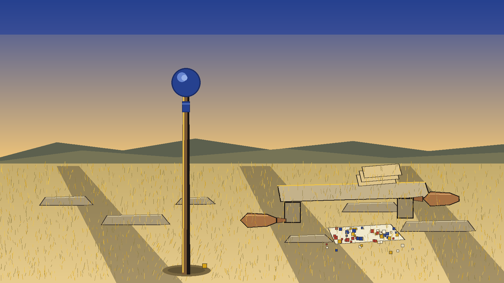
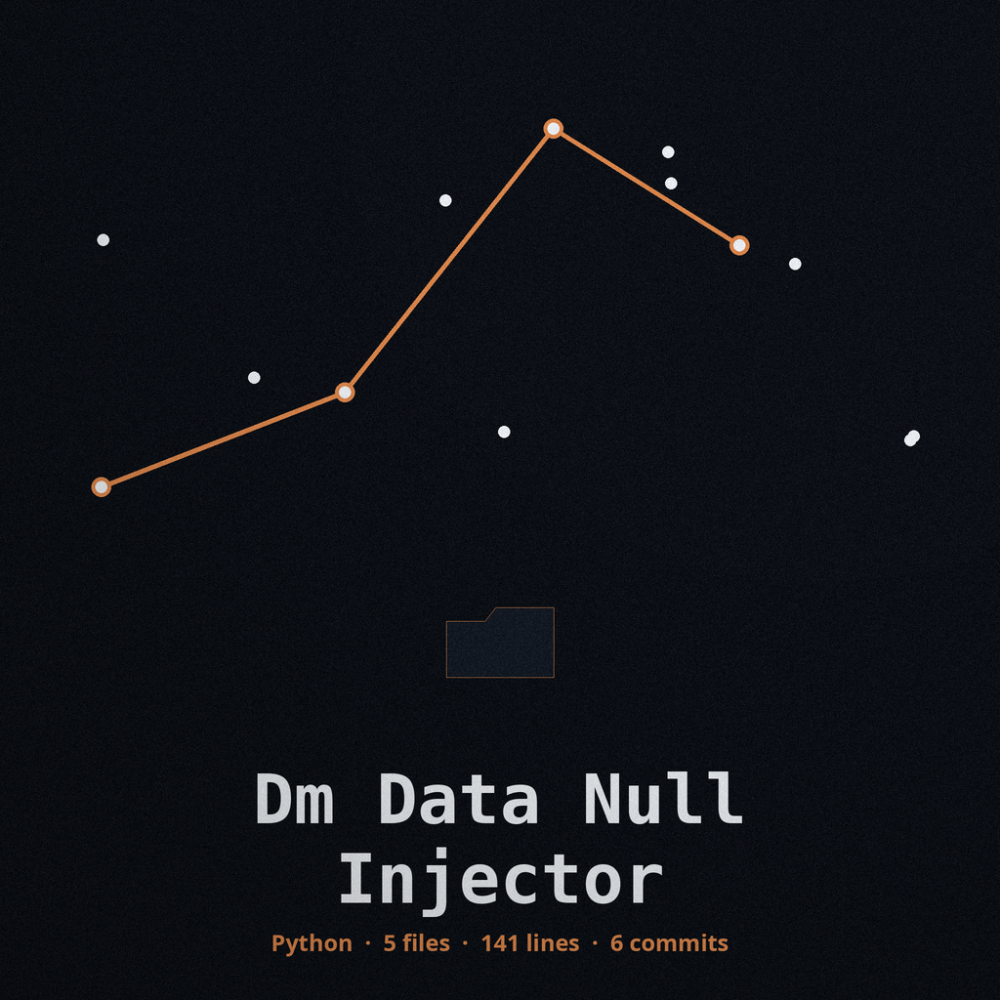
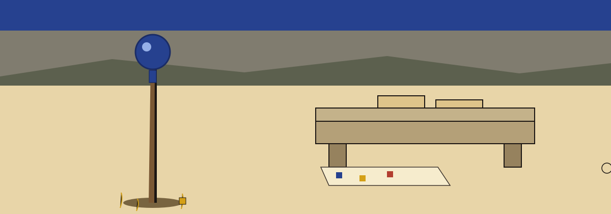

# Chronicle Entry, Late Season at the Thing: dm-data-null-injector

The plain is ready before anyone speaks. A lawspeaker staff stands in the grass, wax tablets sit blank on the stone bench, and small tesserae lie spilled on a cloth. This page keeps that order: the picture first, the name carved next, and the record after.

> Wax tablet: The Output Is Never the Input. The output file must not be the input file, and a run that would write onto its own input refuses at exit 1 before any write.

> Wax tablet: The probability control has no description in the record below. That gap is printed as a gap, not filled.

> Wax tablet: Pattern and columns both fall back to considering everything when they are not specified.

# dm-data-null-injector
Replaces values within a dataset with null values (None in Python, NULL in SQL, etc.) based on a specified probability or pattern matching. This helps obscure actual data while maintaining data structure and statistical properties. - Focused on Tools designed to generate or mask sensitive data with realistic-looking but meaningless values

## Install
`git clone https://github.com/ShadowGuard-AI/dm-data-null-injector`

A note stands beside this chapter in the website record: the line above names a predecessor house, and it is kept here exactly as published.

## Usage
`python3 main.py input_file output_file [options]`

## Parameters
- `-h`: Show help message and exit
- `--probability`: No description provided
- `--pattern`: Regular expression pattern to match values to be replaced with null.  If not specified, all values are considered.
- `--columns`: Comma-separated list of column names to apply the null injection to. If not specified, all columns are considered.

## Output path

The output file must not be the input file. If the resolved output path equals the resolved input path, the run refuses at exit 1 before any write, including when the same file is named through a ./ alias or a symlink.

## License
This project is released under the MIT License. See the [LICENSE](LICENSE) file for details.

Evening close: the staff rests against a wall indoors, the tablets are stacked and tied, and the record is kept ready to hand on. The plain that opened this page is empty again, and its shape is unchanged.
