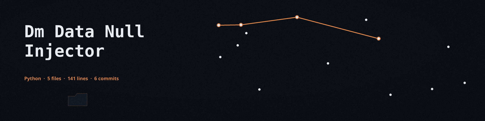

# dm-data-null-injector
Replaces values within a dataset with null values (None in Python, NULL in SQL, etc.) based on a specified probability or pattern matching. This helps obscure actual data while maintaining data structure and statistical properties. - Focused on Tools designed to generate or mask sensitive data with realistic-looking but meaningless values

## Install
`git clone https://github.com/ShadowStrikeHQ/dm-data-null-injector`

## Usage
`./dm-data-null-injector [params]`

## Parameters
- `-h`: Show help message and exit
- `--probability`: No description provided
- `--pattern`: Regular expression pattern to match values to be replaced with null.  If not specified, all values are considered.
- `--columns`: Comma-separated list of column names to apply the null injection to. If not specified, all columns are considered.

## Output path

The output file must not be the input file. If the resolved output path equals the resolved input path, the run refuses at exit 1 before any write, including when the same file is named through a ./ alias or a symlink.

## License
Copyright (c) ShadowStrikeHQ
